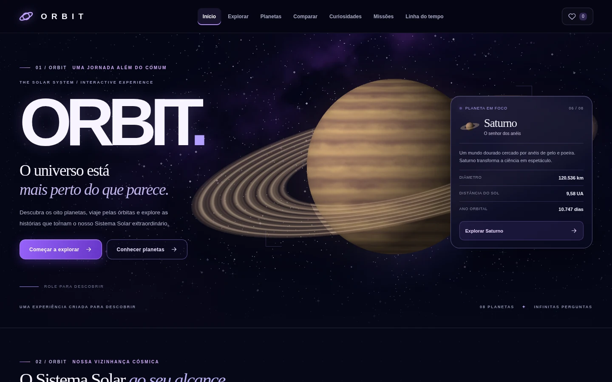

# ORBIT ✦ Explore o Sistema Solar

> O universo está mais perto do que parece.

**ORBIT** é uma experiência de exploração do Sistema Solar com estética cinematográfica espacial: oito planetas, simulador orbital em Canvas, dados científicos, comparador, curiosidades, missões e linha do tempo. Projeto autoral de **Luana Figueiredo**.



## Explorar

| Área | Funcionalidades |
|---|---|
| **Início** | Hero com Saturno, painel de planeta selecionável, oito miniaturas, quatro portais interativos e carrossel de curiosidades |
| **Explorar** | Simulação orbital interativa em Canvas 2D, seleção dos planetas, pausa/continuação, velocidade, zoom, rótulos e reinício |
| **Planetas** | Catálogo dos oito planetas, pesquisa e filtros por categoria; página própria para cada planeta |
| **Comparar** | Dois planetas escolhidos, dados lado a lado e barras interativas para sete métricas |
| **Curiosidades** | 24 histórias com filtros, busca, modal de leitura, relação com planetas e favoritos |
| **Missões** | 10 missões de exploração espacial, pesquisa, filtros e links para referências científicas |
| **Linha do tempo** | 14 marcos da astronomia e da exploração espacial, com filtros |
| **Minha coleção** | Favoritos locais de planetas, curiosidades e missões |
| **Contato** | Convite discreto no rodapé de todas as páginas, com o meu e-mail profissional clicável |


## Tecnologias

- HTML5 
- CSS moderno (grid, responsividade, transições, custom properties)
- JavaScript
- Canvas 2D para a simulação orbital
- `localStorage` para favoritos
- Ilustrações planetárias **autorais e procedurais**, incluídas nos assets para funcionar sem conexão com serviços de imagens

## Estrutura

```text
ORBIT/
├─ index.html
├─ favicon.svg
├─ style.css
├─ js/
│  ├─ data.js          # Planetas, curiosidades, missões, cronologia, fontes
│  ├─ orbits.js        # Simulador Canvas
│  └─ app.js           # Telas, navegação, controles, eventos, favoritos
├─ assets/             # Fundo espacial e imagens dos planetas
├─ tests/
│  └─ check-data.js    # Validação automatizada dos dados (Node.js opcional)
├─ ABRIR_ORBIT.bat
├─ DADOS_E_FONTES.md
└─ README.md
```

## Dados e transparência

Os dados dos planetas são aproximados e têm como referências principais a **NASA Planetary Fact Sheet** e o **NASA/JPL Planetary Physical Parameters**. Quantidades de luas variam com novas descobertas. A simulação orbital é **esquemática, fora de escala**: usa períodos relativos aproximados, posições iniciais ilustrativas e não representa posições astronômicas atuais. **Não a utilize para navegação, observação preditiva ou cálculos científicos.**

As imagens planetárias são **ilustrações digitais geradas por código**, não fotografias oficiais da NASA. Este projeto **não é afiliado, patrocinado ou endossado pela NASA**.

Consulte [`DADOS_E_FONTES.md`](DADOS_E_FONTES.md) para links das referências.


## Contato

**Luana Figueiredo**  
**luanafigueiredo.dev@gmail.com**

— ORBIT, um projeto independente de front-end.

## Atualização — NOCTIS

- Adicionado o **NOCTIS**, observatório astronômico acessível pelo menu e pela página inicial do ORBIT.
- Mapa celeste 2D com estrelas, constelações, seleção de localização, data, horário e controles de visualização.
- Novas áreas: **Esta Noite**, **Atlas Celestial**, **SIDERAL** e **Eventos**.
- O catálogo inicial reúne estrelas e objetos do espaço profundo. O SIDERAL utiliza ilustrações identificadas como artísticas; não é uma visualização 3D.
- As posições da Lua e dos planetas dependem do carregamento da biblioteca Astronomy Engine pela internet. O mapa não representa uma transmissão ao vivo nem prevê condições meteorológicas.


